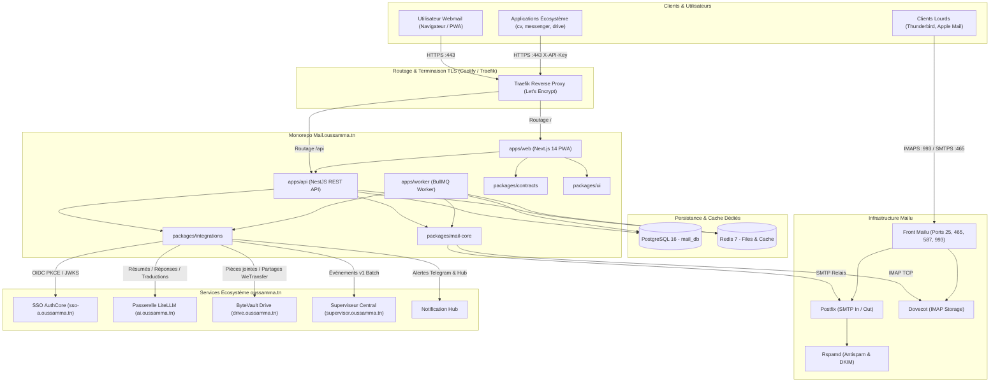
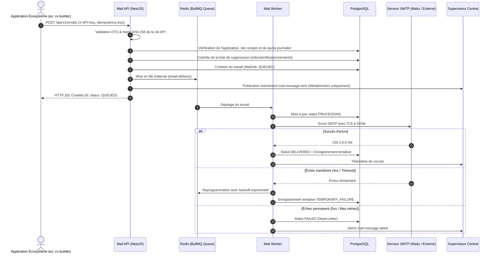

# Architecture Logicielle — Mail.oussamma.tn

## 1. Vue d'Ensemble

**Mail.oussamma.tn** est une plateforme unifiée et indépendante combinant deux missions critiques au sein de l'écosystème `oussamma.tn` :
1. **Webmail Utilisateur PWA :** Messagerie mobile-first responsive avec navigation par dossiers, recherche, lecture HTML désinfectée, pièces jointes Cloud (ByteVault Drive), et assistance IA contextuelle (LiteLLM).
2. **Mailing Transactionnel Centralisé :** API REST sécurisée pour toutes les applications de l'écosystème (`cv`, `messenger`, `drive`, `devspace`), avec authentification M2M par clés d'API hachées, gestion fine des scopes, quotas, rate limiting, files d'attente asynchrones BullMQ, gestion de l'idempotence et supervision centrale.

---

## 2. Diagramme d'Architecture Globale

---

## 3. Flux Séquentiel — Envoi Transactionnel Sécurisé

---

## 4. Modèle de Responsabilité des Packages

- **`packages/contracts` :** Source unique de vérité pour les types, schémas Zod et contrats partagés entre le frontend, le backend et les workers.
- **`packages/mail-core` :** Moteur d'envoi SMTP (avec mode simulé étanche), adaptateur IMAP avec pagination incrémentale, moteur de templates typé avec échappement XSS, et cryptographie AES-256-GCM / Argon2.
- **`packages/integrations` :** Connecteurs certifiés pour l'écosystème : SSO OIDC (PKCE S256), passerelle LiteLLM avec prompt isolation, Drive ByteVault, Superviseur v1, et Notification Hub avec déduplication.
- **`packages/ui` :** Composants réutilisables basés sur Tailwind CSS et respectant la charte visuelle unifiée (Plus Jakarta Sans, palette slate/blue, badges et boutons ergonomiques).
