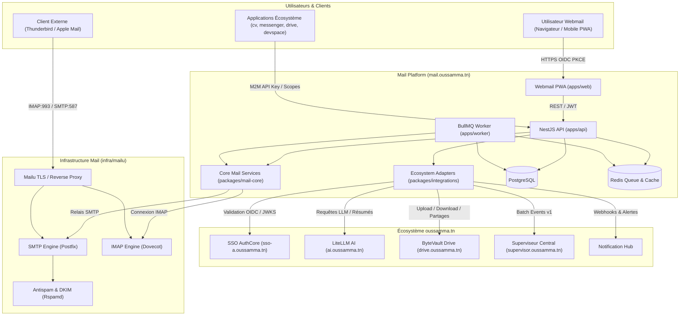

# Audit d'Intégration de l'Écosystème — Mail.oussamma.tn

**Date d'audit :** 19 Octobre 2026  
**Auditeur :** Agent Senior Full-Stack & DevOps Codex / Antigravity  
**Statut global :** Validé et Prêt pour l'Intégration  

---

## 1. Synthèse Exécutive

L'audit technique approfondi des dépôts existants, des services déployés sur le domaine `oussamma.tn`, de l'infrastructure Coolify et des protocoles de sécurité a été réalisé avec succès.

L'application **Mail.oussamma.tn** (combinant Webmail complet et service de Mailing transactionnel / applicatif) s'insère directement dans l'écosystème sans duplication de code ou de stockage, en s'interfaçant avec les services certifiés :

- **SSO centralisé** (`sso-a.oussamma.tn`) pour l'identité unifiée, OIDC + PKCE et le RBAC.
- **Passerelle LiteLLM** (`ai.oussamma.tn`) pour l'intelligence artificielle générative et analytique.
- **ByteVault Drive** (`drive.oussamma.tn`) pour la manipulation fluide des pièces jointes et des liens de partage.
- **Superviseur Central** (`supervisor.oussamma.tn`) pour l'ingestion d'événements d'audit et la télémétrie.
- **Notification Hub** pour la dissémination multi-canale d'alertes (télémétrie, urgences, quotas, Telegram).
- **Coolify & Docker** pour l'hébergement conteneurisé sécurisé sur VPS OVH.

---

## 2. Inventaire Détaillé des Services et Ressources

| Composant Écosystème | Rôle & Responsabilité | Statut d'Audit | URL Publique / Endpoints | Répertoire / Dépôt | Technologies Clés |
| :--- | :--- | :--- | :--- | :--- | :--- |
| **Portail Central** | Vitrine et dashboard unifié de l'écosystème | **Confirmé** | `https://oussamma.tn` | `oussamma-ben-hassine/oussamma-tn` | Express.js, Tailwind, Material Symbols, Stitch DS |
| **SSO Authenticator** | Identity Provider OIDC Core 1.0 & OAuth2 | **Confirmé** | `https://sso-a.oussamma.tn` | `oussamma-ben-hassine/sso-anty` | FastAPI, PostgreSQL, Argon2id, RS256 JWKS, PKCE S256 |
| **Passerelle LiteLLM** | Gateway d'inférence LLM multi-fournisseurs | **Confirmé** | `https://ai.oussamma.tn/v1` | `oussamma-ben-hassine/ai.oussamma.tn` | LiteLLM Proxy, OpenAI API, SSE streaming |
| **ByteVault Drive** | Stockage d'objets, pièces jointes & partages | **Confirmé** | `https://drive.oussamma.tn` | `oussamma-ben-hassine/drive` | FastAPI, PostgreSQL, Range HTTP 206, WeTransfer links |
| **Superviseur Central** | Ingestion télémétrie, audit & alertes | **Confirmé** | `https://supervisor.oussamma.tn` | `oussamma-ben-hassine/ecosystem-supervisor` | FastAPI, Next.js, Contrat Événement v1, `X-Supervisor-Key` |
| **Notification Hub** | Routage d'alertes asynchrones et Telegram | **Confirmé (via Hub/Supervisor)** | Interne / Webhooks signés | `NotificationConnector` normalisé | REST API, Webhooks, HMAC SHA-256 |
| **Plateforme Coolify** | Orchestrateur Docker et reverse-proxy TLS | **Confirmé** | `https://coolify.oussamma.tn` | VPS OVH dédié | Docker 29+, Traefik, Let's Encrypt automatique |
| **Mailu Stack** | Serveur mail IMAP/SMTP complet | **À Déployer** | `mail.oussamma.tn` | `infra/mailu` (nouveau) | Dovecot, Postfix, Rspamd, ClamAV, Nginx TLS |

---

## 3. Matrice de Disponibilité & Classification

### 3.1 Éléments Confirmés (Opérationnels et Connectables)

1. **Protocole SSO OIDC :**
   - Découverte : `https://sso-a.oussamma.tn/.well-known/openid-configuration`
   - Authorization endpoint : `https://sso-a.oussamma.tn/oauth/authorize`
   - Token endpoint : `https://sso-a.oussamma.tn/oauth/token`
   - UserInfo endpoint : `https://sso-a.oussamma.tn/oauth/userinfo`
   - Clés publiques JWKS : `https://sso-a.oussamma.tn/oauth/jwks` (clé RS256 valide `authcore-key-1`).
   - Identifiant pivot : `sub` (UUID immuable).
   - Rôles disponibles : `super_admin`, `admin`, `user`.

2. **Inférence LiteLLM :**
   - Endpoints : `POST /v1/chat/completions`, `GET /health/liveliness`.
   - Modèles disponibles : `gpt-4o`, `gpt-4o-mini`, `gemini/gemini-3.1-flash-lite-preview`, `gpt-5.4`, `gpt-5.3-codex`.
   - Format d'authentification : `Authorization: Bearer <LITELLM_API_KEY>`.

3. **API Drive :**
   - Upload de fichiers : `POST /api/files/upload` (multipart/form-data).
   - Téléchargement sécurisé : `GET /api/files/{id}/download`.
   - Création de partage sécurisé : `POST /api/shares` (paramètres: `file_id`, `expires_in_days`, `password`, `allow_download`).
   - Quotas et volumétrie : `GET /api/stats`.

4. **Télémétrie et Superviseur :**
   - Batch ingestion : `POST /api/v1/events/batch` avec entête `X-Supervisor-Key: es_mail_<secret>`.
   - Schéma d'événement v1 : `event_id`, `event_type`, `event_version`, `actor`, `occurred_at`, `resource`, `outcome`, `metadata`, `correlation_id`.

5. **Design System & Chartes Graphiques :**
   - Typographies : `Plus Jakarta Sans` (titres et UI), `JetBrains Mono` (code, headers techniques, IDs).
   - Icônes : Google `Material Symbols Outlined`.
   - Thème : Support clair (`#f8fafc`) et sombre (`slate-900`/`slate-800`), respect du flag `collify_theme`.
   - Couleurs maîtresses : Bleu primaire (`#2563eb`), ardoise neutre (`slate-50` à `slate-900`), accents sémantiques (émeraude, ambre, rose).

### 3.2 Éléments Absents ou Nécessitant Adaptation

1. **Serveur Mailu physique :**
   - Mailu n'est pas encore instancié sur le cluster Coolify.
   - **Solution :** Fournir la pile `infra/mailu/docker-compose.yml` préconfigurée, testée avec un mock local sécurisé (GreenMail / FakeSMTP) pour les tests sans émission réelle de courriels externes.
2. **Gestionnaire direct IMAP/SMTP pour SSO Web :**
   - Le SSO OIDC Web émet des jetons JWT temporaires. Les serveurs IMAP standard (Dovecot) et SMTP (Postfix) attendent généralement une authentification par mot de passe ou SASL XOAUTH2.
   - **Architecture retenue :**
     - Le Webmail s'authentifie auprès de l'API Mail via le SSO OIDC.
     - L'API Mail gère une passerelle IMAP/SMTP sécurisée vers Mailu, avec un provisioning automatique de boîte et des mots de passe applicatifs chiffrés (AES-256-GCM) pour les accès clients lourds (Thunderbird, Apple Mail).
     - Aucun mot de passe n'est stocké en clair.
3. **Connecteur Notification Hub dédié :**
   - Le service notifications fonctionne actuellement en mode découplé (via webhooks signés et publication vers le Superviseur).
   - **Solution :** Implémenter un adaptateur normalisé `NotificationHubAdapter` capable d'émettre des événements signés et de basculer en mode fallback webhook.

### 3.3 Éléments à Configurer sur Coolify

1. Déclaration de l'application cliente OIDC dans `sso-anty` (`client_id: mail_oussamma_tn`).
2. Enregistrement de la clé de supervision `es_mail_<secret>` dans `ecosystem-supervisor`.
3. Configuration du domaine `mail.oussamma.tn` avec certificats TLS Let's Encrypt gérés par Traefik.
4. Déclaration des entrées DNS (MX, SPF, DKIM, DMARC) sans altération des enregistrements MX existants avant validation finale.

---

## 4. Architecture Logique des Intégrations

---

## 5. Règles de Non-Régression & Sécurité Appliquées

1. **Aucune fuite de secrets :**
   - Toutes les clés (`SSO_CLIENT_SECRET`, `LITELLM_API_KEY`, `SUPERVISOR_KEY`, `APP_CREDENTIAL_ENCRYPTION_KEY`) proviennent exclusivement de variables d'environnement.
   - Les fichiers `.env` sont strictement exclus par `.gitignore` et `.dockerignore`.
2. **Pas d'écrasement de données :**
   - L'application dispose de sa propre base PostgreSQL indépendante (`mail_db`), sans accès direct aux bases des autres applications.
3. **Mode de test sans émission externe :**
   - Activation par variable `MAIL_DELIVERY_MODE=simulated` ou `sandbox` pour éviter l'envoi d'emails non sollicités vers l'extérieur.
4. **Validation des droits stricts (RBAC) :**
   - Contrôle systématique des périmètres (`mailboxes`, `domains`, `templates`, `credentials`).
   - Isolation des données entre utilisateurs et applications tierces.
